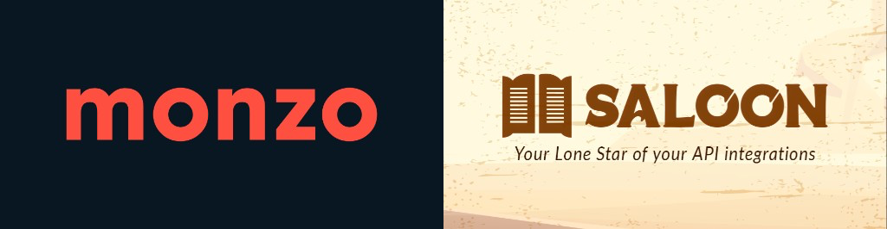

<p align="center">
    
    <p align="center">
        <a href="https://github.com/JonPurvis/monzo-php-sdk/actions"></a>
        <a href="https://packagist.org/packages/jonpurvis/monzo-php-sdk"></a>
        <a href="https://packagist.org/packages/jonpurvis/monzo-php-sdk"></a>
        <a href="https://packagist.org/packages/jonpurvis/monzo-php-sdk"></a>
    </p>
</p>

------

# Monzo PHP SDK

## 👋 Introduction

Framework-agnostic client for the [Monzo Developer API](https://docs.monzo.com/), built with [Saloon](https://docs.saloon.dev/) v4.

The Monzo Developer API is for personal integrations (your account or a small set of users you explicitly allow). It is not intended for public apps. See Monzo’s documentation for Strong Customer Authentication and usage limits.

## 📦 Installation

```bash
composer require jonpurvis/monzo-php-sdk
```

Register a client at [developers.monzo.com](https://developers.monzo.com) to obtain `client_id`, `client_secret`, and a `redirect_uri`.

## 🧩 Creating a client

```php
<?php

use JonPurvis\Monzo\Monzo;

// API calls with an access token only
$monzo = Monzo::connect(accessToken: $accessToken);

// OAuth setup (token exchange / refresh) — pass client credentials once
$monzo = Monzo::connect(
    clientId: $clientId,
    clientSecret: $clientSecret,
    redirectUri: $redirectUri,
);

// Combine: credentials for OAuth + token for API calls
$monzo = Monzo::connect(
    accessToken: $accessToken,
    clientId: $clientId,
    clientSecret: $clientSecret,
    redirectUri: $redirectUri,
);

// Immutable-style token swap (returns a new connector instance)
$monzo = $monzo->withAccessToken($newAccessToken);

// Set or replace OAuth client settings
$monzo = $monzo->withOAuthClient($clientId, $clientSecret, $redirectUri);
```

All resource methods return a `JonPurvis\Monzo\MonzoResponse` (Saloon response). Call `->throw()` to convert HTTP errors into `JonPurvis\Monzo\Exceptions\MonzoRequestException`, or use `->json()`, `->status()`, etc. directly.

## 🔐 OAuth 2.0

Monzo uses OAuth 2.0 with optional refresh tokens for **confidential** clients. **Token storage is your application’s responsibility** — persist `access_token`, `refresh_token`, and expiry (e.g. from `expires_in`). Do not serialize Saloon `AccessTokenAuthenticator` objects ([Saloon v4 notes](https://docs.saloon.dev/upgrade/upgrading-from-v3-to-v4)).

### Authorization URL

Send the user to Monzo (include a CSRF `state` you verify on callback):

```php
$url = $monzo->oauth()->authorizationUrl(state: $csrfToken);

// Saloon's authorization-code grant on the connector (same URL, generated state when omitted):
$url = $monzo->getAuthorizationUrl(state: $csrfToken);
$expectedState = $monzo->getState();

// Or without a connector:
use JonPurvis\Monzo\OAuth\AuthorizationUrl;

$url = AuthorizationUrl::make($clientId, $redirectUri, $state);
```

User flow: browser login → approve access in the Monzo app → redirect to your `redirect_uri` with `?code=...&state=...`. If `state` does not match the value you sent, abort the exchange.

A client may only have one active access token per user. A new token, including a refresh, invalidates the previous one. Refresh tokens are single-use. Confidential clients receive a refresh token; non-confidential clients do not, and must send the user through login again. The access token has no permissions until the user approves access in the Monzo app.

### Token exchange, refresh, logout

```php
$tokens = $monzo->oauth()
    ->exchangeAuthorizationCode($authorizationCode, $state, $expectedState)
    ->throw()
    ->json();

// $tokens: access_token, refresh_token, expires_in, token_type, user_id, client_id

$monzo = $monzo->withAccessToken($tokens['access_token']);

$refreshed = $monzo->oauth()
    ->refreshAccessToken($tokens['refresh_token'])
    ->throw()
    ->json();

// Store the new access_token and refresh_token. The previous refresh token cannot be used again.

$monzo->oauth()->logout()->throw(); // invalidates token; user must re-authenticate

// Or Saloon's grant helpers, which return an authenticator. Persist the token fields yourself.
$authenticator = $monzo->getAccessToken($authorizationCode, $state, $expectedState);
$monzo->authenticate($authenticator);
$authenticator = $monzo->refreshAccessToken($authenticator);
```

### Whoami

Inspect the current access token:

```php
$whoami = $monzo->oauth()->whoami()->throw()->json();
// authenticated, client_id, user_id
```

## ✨ API reference

| Resource | Methods |
|----------|---------|
| `oauth()` | `authorizationUrl()`, `whoami()`, `exchangeAuthorizationCode()`, `refreshAccessToken()`, `logout()` |
| `accounts()` | `list(?accountType)` |
| `balance()` | `get(accountId)` |
| `pots()` | `list(currentAccountId)`, `deposit()`, `withdraw()` |
| `transactions()` | `get()`, `list()`, `paginate()`, `annotate()` |
| `feed()` | `create()`, `createBasic()` |
| `attachments()` | `requestUploadUrl()`, `uploadToUrl()`, `uploadAndRegister()`, `register()`, `deregister()` |
| `receipts()` | `create()`, `get()`, `delete()` |
| `webhooks()` | `list()`, `register()`, `delete()` |

### Accounts

**`GET /accounts`**

```php
$response = $monzo->accounts()->list()->throw();
$accounts = $response->json('accounts');

// Optional filter. Documented values: uk_retail, uk_retail_joint.
$retail = $monzo->accounts()->list(accountType: 'uk_retail')->throw()->json('accounts');
```

### Balance

**`GET /balance`**

```php
$balance = $monzo->balance()
    ->get(accountId: 'acc_...')
    ->throw()
    ->json();

// balance, total_balance, currency, spend_today (amounts in minor units, e.g. pence)
```

### Pots

**`GET /pots`**, **`PUT /pots/{id}/deposit`**, **`PUT /pots/{id}/withdraw`**

```php
$pots = $monzo->pots()
    ->list(currentAccountId: 'acc_...')
    ->throw()
    ->json('pots');

$monzo->pots()->deposit(
    potId: 'pot_...',
    amount: 1000,
    sourceAccountId: 'acc_...',
    dedupeId: 'stable-between-retries',
)->throw();

$monzo->pots()->withdraw(
    potId: 'pot_...',
    amount: 500,
    destinationAccountId: 'acc_...',
    dedupeId: 'stable-between-retries',
)->throw();
```

Amounts are minor units (pence). `dedupe_id` is required. If you omit it, the SDK generates one and reuses it for that request object. Pots with added security cannot be withdrawn from through the API.

### Transactions

**`GET /transactions`**, **`GET /transactions/{id}`**, **`PATCH /transactions/{id}`** (annotate metadata)

```php
$tx = $monzo->transactions()
    ->get('tx_...', expand: ['merchant'])
    ->throw()
    ->json('transaction');

$list = $monzo->transactions()->list(
    accountId: 'acc_...',
    since: '2025-01-01T00:00:00Z',
    before: '2025-12-31T23:59:59Z',
    limit: 100,
    expand: ['merchant'],
)->throw()->json('transactions');

$monzo->transactions()->annotate(
    transactionId: 'tx_...',
    metadata: ['foo' => 'bar'],
    notes: 'Optional note',
)->throw();

foreach ($monzo->transactions()->paginate(accountId: 'acc_...', limit: 100)->items() as $transaction) {
    // Pages with `since` set to the last transaction id. Default page size is 30, maximum 100.
}
```

**SCA / history:** After the user authenticates, you can usually fetch full transaction history initially; after ~5 minutes, sync may be limited to roughly the last 90 days unless you stored history at auth time. Plan accordingly ([Monzo docs](https://docs.monzo.com/)).

### Feed items

**`POST /feed`** — create a `basic` feed item in the user’s Monzo feed.

```php
$monzo->feed()->createBasic(
    accountId: 'acc_...',
    title: 'My custom item',
    imageUrl: 'https://example.com/image.png',
    url: 'https://example.com/on-tap',
    body: 'Body text',
    backgroundColor: '#FCF1EE',
    titleColor: '#333333',
    bodyColor: '#666666',
)->throw();

$monzo->feed()->create(
    accountId: 'acc_...',
    type: 'basic',
    params: [
        'title' => 'Title',
        'image_url' => 'https://example.com/image.png',
    ],
    url: 'https://example.com',
)->throw();
```

### Attachments

Register images (e.g. receipts) against transactions.

1. **`POST /attachment/upload`** — get `upload_url` and `file_url`
2. **POST** file bytes to `upload_url` (pre-signed; not Monzo’s API host)
3. **`POST /attachment/register`** — link `file_url` to a transaction
4. **`POST /attachment/deregister`** — remove by attachment id

```php
$upload = $monzo->attachments()
    ->requestUploadUrl('receipt.png', 'image/png', strlen($bytes))
    ->throw()
    ->json();

$monzo->attachments()
    ->uploadToUrl($upload['upload_url'], $bytes, 'image/png')
    ->throw();

$monzo->attachments()
    ->register('tx_...', $upload['file_url'], 'image/png')
    ->throw();

$monzo->attachments()->uploadAndRegister(
    transactionId: 'tx_...',
    fileName: 'receipt.png',
    fileContents: $bytes,
    fileType: 'image/png',
)->throw();

$monzo->attachments()->register('tx_...', 'https://example.com/receipt.png', 'image/png')->throw();

$monzo->attachments()->deregister('attach_...')->throw();
```

### Receipts

**`PUT /transaction-receipts`** (JSON body), **`GET`**, **`DELETE`** by `external_id`.

`external_id` is your idempotency key (e.g. order number). Re-`create()` with the same `external_id` updates the receipt.

```php
$receipt = [
    'transaction_id' => 'tx_...',
    'external_id' => 'order-12345',
    'total' => 1299,
    'currency' => 'GBP',
    'items' => [
        [
            'description' => 'Coffee',
            'quantity' => 1,
            'amount' => 1299,
            'currency' => 'GBP',
        ],
    ],
    'taxes' => [],
    'payments' => [],
];

$monzo->receipts()->create($receipt)->throw();

$fetched = $monzo->receipts()->get('order-12345')->throw()->json('receipt');

$monzo->receipts()->delete('order-12345')->throw();
```

See [Monzo receipt schema](https://docs.monzo.com/) for `items`, `taxes`, `payments`, and `merchant` fields.

### Webhooks

**`POST /webhooks`**, **`GET /webhooks`**, **`DELETE /webhooks/{id}`**

```php
$created = $monzo->webhooks()
    ->register(accountId: 'acc_...', url: 'https://example.com/monzo/webhook')
    ->throw()
    ->json('webhook');

$list = $monzo->webhooks()->list('acc_...')->throw()->json('webhooks');

$monzo->webhooks()->delete('webhook_...')->throw();
```

Monzo POSTs to your URL when events occur. The documented event is **`transaction.created`**. Failed deliveries are retried up to 5 times with exponential backoff.

```php
use JonPurvis\Monzo\Webhooks\TransactionCreated;

$event = TransactionCreated::fromPayload($payload);
$event->data['id'];
```

## ⚠️ Errors

| HTTP | Typical meaning |
|------|-----------------|
| 400 | Bad request |
| 401 | Unauthorized (`error: invalid_token` when token expired/invalid) |
| 403 | Forbidden |
| 404 | Not found |
| 429 | Rate limited |
| 5xx | Monzo server / gateway errors |

```php
use JonPurvis\Monzo\Exceptions\MonzoRequestException;

try {
    $monzo->accounts()->list()->throw();
} catch (MonzoRequestException $e) {
    $e->status;
    $e->errorCode;
    $e->responseBody;
    $e->getResponse();
}
```

`throw()` uses Saloon’s [`getRequestException()`](https://docs.saloon.dev/the-basics/handling-failures) hook. `MonzoRequestException` extends Saloon’s `RequestException`.

## 🛠 Advanced: Saloon requests

Every endpoint has a dedicated request class under `JonPurvis\Monzo\Requests\` if you prefer Saloon’s `send()` API or need to customise headers/plugins:

```php
use JonPurvis\Monzo\Requests\Ping\WhoamiRequest;

$response = $monzo->send(new WhoamiRequest());
```

Request classes map to the public API documented at [docs.monzo.com](https://docs.monzo.com/).

## 🧪 Development

See [CONTRIBUTING.md](CONTRIBUTING.md) for setup, `composer lint`, PHPStan (max level), Rector, and PHPUnit.

```bash
composer install
composer test
```

Tests use Saloon `MockClient` and fixtures in `tests/Fixtures/Saloon/` (payloads based on official API documentation).

## 📄 Changelog, contributing & security

- [Changelog](CHANGELOG.md)
- [Contributing](CONTRIBUTING.md)
- [Security policy](SECURITY.md)

## License

MIT — see [LICENSE](LICENSE).
